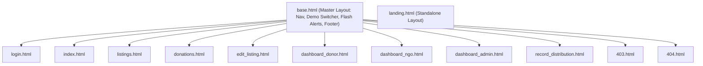
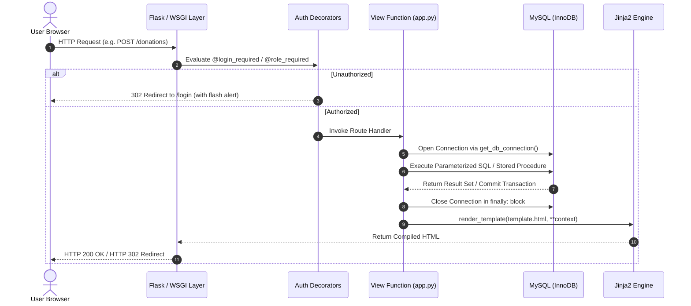
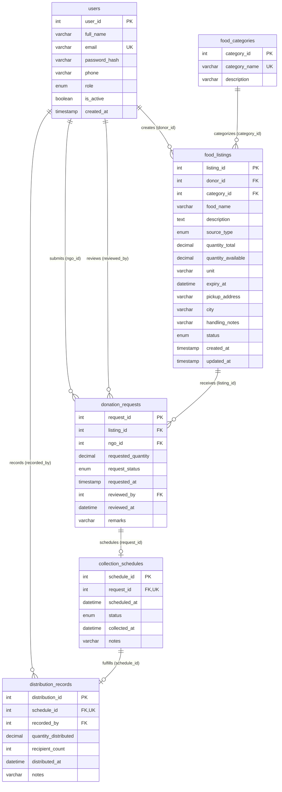
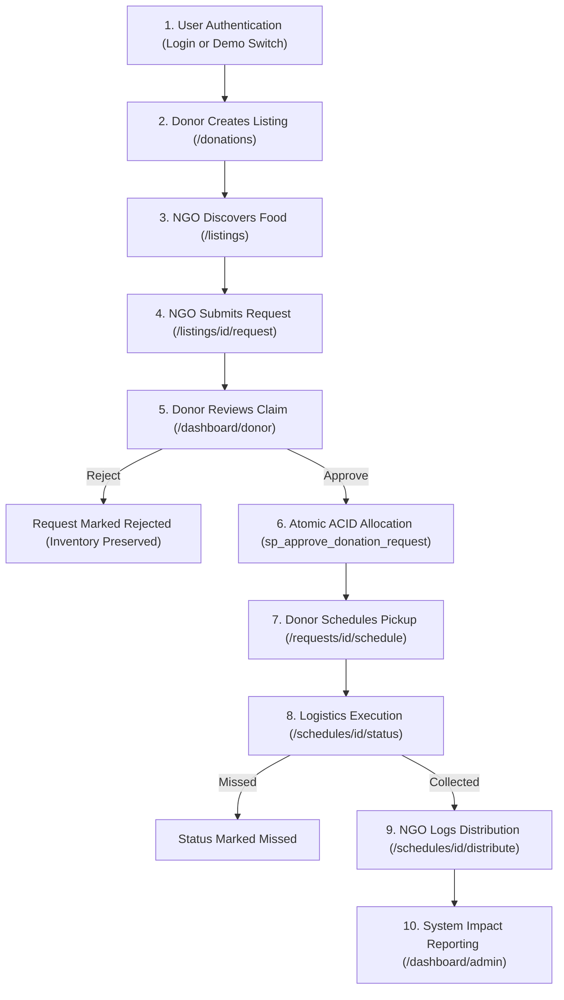

# PLENTIQ — Technical Inventory, Architecture & Viva Defense Manual
**Surplus Food Redistribution and Donation Management System**  
*Comprehensive Technical Documentation for Academic Project Defense & Viva Voce*  
*Target Audience: Computer Science & Engineering Undergraduate Students, Examiners, and Technical Evaluators*

---

## 1. Executive Summary

### 1.1 Project Overview
**PLENTIQ** is a production-grade, database-driven web application designed to combat food waste and alleviate community hunger by bridging the gap between food donors (such as commercial caterers, hotels, banquet halls, restaurants, corporate cafeterias, and event organizers) and verified Non-Governmental Organizations (NGOs) and community shelters.

Food surplus generation in urban centers is typically time-sensitive, perishable, and unpredictable. Traditional manual coordination through phone calls or ad-hoc messaging suffers from critical flaws:
- No real-time visibility into available quantities or strict safe consumption deadlines.
- Risk of over-allocation, where multiple volunteer groups claim the same batch of food.
- Absence of auditable safety guidelines, handling notes, and temperature requirements.
- Lack of verifiable pickup scheduling and proof of post-collection distribution.

PLENTIQ solves these systemic issues by implementing a synchronized, five-stage lifecycle:
1. **Food Listing Registration:** Donors log surplus food with verified quantities, safe expiry timestamps, and handling instructions.
2. **Catalog Browsing & Discovery:** Verified NGOs browse, filter by location, category, and expiry, and submit portion-specific donation requests.
3. **Atomic Concurrency-Controlled Approval:** Listing donors or platform administrators review requests. Quantity deduction is enforced at the database level using atomic ACID transactions and row-level locking (`SELECT ... FOR UPDATE`), preventing double-allocation race conditions.
4. **Logistics Scheduling & Pickup Verification:** A formal pickup schedule is agreed upon, followed by status tracking (`scheduled` &rarr; `collected` or `missed`).
5. **Community Distribution Audit:** Upon physical receipt, the NGO records the exact quantity distributed, recipient beneficiary count, and timestamps, creating a transparent, closed-loop impact record.

### 1.2 Architectural Philosophy
PLENTIQ is built upon a **Layered Monolithic Architecture** utilizing **Python 3.12**, the **Flask** web framework, and **MySQL 8.0 (InnoDB)**. 

Key engineering decisions:
- **No Heavy ORM:** Object-Relational Mappers (such as SQLAlchemy) abstract away SQL execution. PLENTIQ purposefully utilizes the official `mysql-connector-python` library with explicit, parameterized SQL queries and stored procedures. This provides students with direct pedagogical exposure to relational algebra, concurrency control, explicit isolation levels, and ACID compliance.
- **Defense-in-Depth Concurrency:** Two robust approval transaction mechanisms exist in parallel: an optimized MySQL Stored Procedure (`sp_approve_donation_request`) executed via `CALL`, and a pure Python ACID transaction fallback with explicit row locking (`SELECT ... FOR UPDATE`), ensuring uninterrupted reliability.
- **Server-Side Rendered (SSR) UI:** Utilizing Jinja2 templates and native semantic CSS3 without heavy client-side JavaScript frameworks. This guarantees deterministic rendering, low latency, robust accessibility, and zero frontend bundle build overhead.
- **Strict Role-Based Access Control (RBAC):** Backend decorators (`@login_required`, `@role_required`) and ownership predicates strictly enforce authorization across three discrete roles: **Donor**, **NGO**, and **Admin**.

---

## 2. Complete Technology Stack

```mermaid
graph TD
    Client["Client Browser (HTML5 / CSS3 / Vanilla JS)"]
    WSGI["Werkzeug WSGI & Session Layer"]
    Flask["Flask 3.1.3 Application Core (app.py)"]
    Jinja["Jinja2 3.1.6 Template Engine"]
    Driver["mysql-connector-python 26.7.0"]
    MySQL[("MySQL Server 8.0.46 (InnoDB Engine)")]
    
    Client <-->|HTTP / HTML Form POST / GET| WSGI
    WSGI <--> Flask
    Flask -->|Context Data| Jinja
    Jinja -->|Rendered HTML Response| Client
    Flask <-->|Parameterized SQL / CALL Stored Procedures| Driver
    Driver <-->|TCP Socket (Port 3306) / Transactions| MySQL
```

### 2.1 Core Technologies Table

| Technology | Category | Exact Version | Primary Purpose in PLENTIQ | Key Source Files |
|---|---|---|---|---|
| **Python** | Language | `3.12.0` | Core programming language for backend business logic, routing, data validation, and database orchestration. | `app.py`, `db_config.py` |
| **Flask** | Backend Framework | `3.1.3` | Lightweight WSGI micro-framework providing HTTP request dispatching, URL routing, session handling, error handling, and template context injection. | `app.py` |
| **MySQL Server** | Relational DBMS | `8.0.46` | Relational database management system utilizing the transactional InnoDB engine for persistent, ACID-compliant storage of users, listings, requests, schedules, and distributions. | `plentiq_setup.sql`, `plentiq_workflow.sql` |
| **mysql-connector-python** | Database Driver | `26.7.0` | Official Oracle-supported pure Python MySQL driver used to manage connection pools, cursors, parameterized queries, and stored procedure calls. | `app.py` (`get_db_connection`) |
| **Jinja2** | Template Engine | `3.1.6` | Fast, expressive server-side templating engine used for layout inheritance, conditional HTML rendering, loops, and automated contextual HTML escaping. | `templates/*.html` |
| **Werkzeug** | WSGI Utility Library | `3.1.9` | Underlying WSGI layer powering Flask; provides cryptographic password hashing (`scrypt`) and session cookie signing. | `app.py` (`check_password_hash`) |
| **HTML5 & CSS3** | Frontend Presentation | W3C Standard | Semantic markup and custom responsive CSS utilizing CSS Custom Properties (variables), CSS Grid, and Flexbox. | `static/css/*.css`, `templates/*.html` |
| **Vanilla JavaScript** | Client-Side Interactivity | ES6 | Lightweight, framework-free browser DOM manipulation for dynamic character count tracking and live preview card updates on the donation form. | `templates/donations.html` |
| **Pillow (PIL)** | Image Processing | `13.0.0` | Python imaging library utilized during deployment scripts to inspect, crop, and normalize graphic assets. | Development scripts in `scratch/` |
| **pytest & unittest** | Testing Frameworks | `pytest 9.1.1` / `unittest` stdlib | Automated test runners and assertion frameworks used to execute integration test suites verifying backend routes and database state. | `scratch/test_stage3.py`, `scratch/test_landing.py` |
| **MySQL Workbench** | Administration Tool | `8.0` | Visual database modeling, query verification, execution of stored procedures, and schema inspection tool. | `plentiq_setup.sql`, `plentiq_workflow.sql` |

### 2.2 Technologies Deliberately NOT Used (Common Viva Traps)

During an academic viva, evaluators often probe whether students understand what is **not** in their architecture. Students must clearly articulate why the following were avoided:
- **No ORM (e.g., SQLAlchemy, Django ORM):** PLENTIQ avoids ORM abstraction to maintain direct, granular control over transaction boundaries, row-level lock acquisition (`FOR UPDATE`), and SQL execution plans.
- **No Frontend JavaScript Frameworks (e.g., React, Angular, Vue):** Avoided to eliminate unnecessary build complexities (Node.js, npm, Webpack, Vite), client-side state hydration synchronization issues, and SEO/initial paint penalties.
- **No CSS Component Frameworks (e.g., Bootstrap, Tailwind CSS):** A bespoke CSS system (`style.css`, `landing.css`) was written from scratch. This prevents bloat, ensures a distinct brand identity (forest green `#174c37`), and demonstrates mastery of CSS Grid and Flexbox fundamentals.
- **No Asynchronous Task Queues (e.g., Celery, Redis):** Because collection scheduling and donation requests are interactive and low-latency, immediate transactional database updates are optimal and avoid distributed state inconsistencies.
- **No External NoSQL / Document Store (e.g., MongoDB):** Relational integrity, foreign key cascade restrictions, check constraints, and multi-row ACID transactions are strict requirements for food portion inventory accounting; unstructured document databases are ill-suited for this use case.

---

## 3. Complete Project File and Folder Structure

### 3.1 Project Directory Tree

```
C:\CODING FILES\PLENTIQ\
│
├── app.py                             # Main Flask application (routes, business logic, DB access)
├── db_config.py                       # MySQL database connection configuration dictionary
├── plentiq_setup.sql                  # DDL script: schema, tables, constraints, indexes, demo users
├── plentiq_workflow.sql               # Stored procedures: sp_approve_donation_request & reject
├── db_cleanup_recommendation.sql      # Reference SQL script for safe demonstration data pruning
├── test.sql                           # Utility SQL script for schema, FK, and workflow verification
├── report.sql                         # Scratch SQL buffer
├── test_connection.py                 # Standalone script to verify interactive MySQL connectivity
├── PROJECT_INVENTORY_FOR_DOCUMENTATION.md # Initial inventory assessment report
├── PROJECT_TECHNICAL_INVENTORY.md     # This comprehensive technical manual
├── plentiq_db_backup_20261021_123941.sql # Full mysqldump backup of database prior to cleanup
│
├── static/                            # Publicly served static frontend assets
│   ├── css/
│   │   ├── style.css                  # Core application stylesheet (dashboards, tables, forms)
│   │   └── landing.css                # Specialized standalone stylesheet for the public landing page
│   └── images/
│       ├── plentiq-logo.png           # Plentiq brand logo mark (1024x341 PNG)
│       ├── donor.png                  # Donor persona artwork (671x588 PNG)
│       ├── ngo.png                    # NGO persona community artwork (499x458 PNG)
│       └── admin.png                  # System Administrator persona artwork (512x512 PNG)
│
├── templates/                         # Jinja2 server-side rendered HTML templates
│   ├── base.html                      # Root layout template (navbar, demo switcher, flash, footer)
│   ├── landing.html                   # Unauthenticated landing page (3 demo cards + email link)
│   ├── login.html                     # Standard email and password sign-in form
│   ├── index.html                     # Authenticated home dashboard & platform category explorer
│   ├── listings.html                  # Public / Community surplus food marketplace with filters
│   ├── donations.html                 # 4-stage Add Food Donation form + sidebar & active listings
│   ├── edit_listing.html              # Donor food listing edit form
│   ├── dashboard_donor.html           # Donor management dashboard (listings, requests, pickup status)
│   ├── dashboard_ngo.html             # NGO operation dashboard (claims, schedules, distributions)
│   ├── dashboard_admin.html           # System Administrator oversight dashboard (audit logs & stats)
│   ├── record_distribution.html       # NGO distribution recording form (post-collection impact)
│   ├── 403.html                       # Custom HTTP 403 Forbidden error template
│   └── 404.html                       # Custom HTTP 404 Not Found error template
│
├── scratch/                           # Developer utilities, tests, and temporary execution scripts
│   ├── test_stage3.py                 # Integration tests for collection & distribution workflows
│   ├── test_landing.py                # Smoke tests for landing page and demo switching
│   ├── test_redesigned_donation.py    # Verification script for redesigned donation form
│   ├── verify_navbar_and_login.py     # Regression checks for login and navbar state
│   ├── db_cleanup_and_seed.py         # Automated database purge and demo seed script
│   └── inspect_*.py                   # Schema and image inspection helper scripts
│
└── .venv/                             # Python 3.12 virtual environment (isolated packages)
```

---

## 4. File-by-File Technical Analysis

### 4.1 Application Core & Configuration

#### `app.py`
- **Location:** Project Root
- **Length:** ~2,146 lines
- **Role in System:** The central monolithic controller and entry point of the entire application.
- **Main Contents:**
  - Application factory and configuration initialization (`app.secret_key`, `app.config["DEMO_MODE"] = True`).
  - Predefined demo account mapping dictionary (`DEMO_ACCOUNTS`).
  - Valid enumeration constants (`VALID_SOURCE_TYPES`, `VALID_STATUSES`).
  - Database connection factory: `get_db_connection()`.
  - Transaction helpers:
    - `execute_request_approval()`: Dispatches to stored procedure `sp_approve_donation_request` or falls back to pure Python transaction.
    - `_execute_request_approval_python_transaction()`: Pure Python atomic implementation with `SELECT ... FOR UPDATE`.
    - `execute_request_rejection()` and `_execute_request_rejection_python_transaction()`.
    - `execute_schedule_collection()`: Validates request approval and creates collection schedules.
    - `execute_update_collection_status()`: Transitions schedules between `scheduled`, `collected`, and `missed`.
    - `execute_record_distribution()`: Records final community food delivery.
  - Context processors: `inject_globals()` (injects `current_user`, `demo_mode`, and current timestamp into all templates).
  - Security decorators: `login_required(f)` and `role_required(*allowed_roles)`.
  - All 20 application HTTP routes.
  - Custom HTTP error handlers (`@app.errorhandler(403)`, `@app.errorhandler(404)`).
- **Viva Significance:** When asked "Where does the application execute?", point to `app.py`. Explain how `get_db_connection()` ensures every request opens and closes its database connection cleanly inside `try ... finally` blocks.

#### `db_config.py`
- **Location:** Project Root
- **Length:** 7 lines
- **Role in System:** Database credential configuration module.
- **Main Contents:** Contains the Python dictionary `DB_CONFIG` specifying `host`, `user`, `password`, `database` (`plentiq_db`), and `port` (`3306`).
- **Dependencies:** Imported by `app.py`, `test_connection.py`, and test suites.
- **Security Note:** In a production enterprise deployment, credentials would be loaded from environment variables (`os.environ`). For this academic demonstration, they are maintained in this isolated configuration file.

### 4.2 Database DDL & Stored Procedures

#### `plentiq_setup.sql`
- **Location:** Project Root
- **Length:** 223 lines
- **Role in System:** Complete Data Definition Language (DDL) and initial data seeding script.
- **Main Contents:**
  - `CREATE DATABASE plentiq_db;`
  - Table creation with complete column definitions, data types, and primary keys for all six tables.
  - Foreign key constraints with `ON DELETE RESTRICT` referential actions.
  - Explicit `CHECK` constraints on numeric quantities and recipient counts.
  - Composite and secondary performance indexes.
  - Seed `INSERT` statements for seven standard food categories and three pre-configured demo user accounts with cryptographic password hashes.

#### `plentiq_workflow.sql`
- **Location:** Project Root
- **Length:** 279 lines
- **Role in System:** Stored procedure definitions for ACID concurrency control.
- **Main Contents:**
  - `sp_approve_donation_request`: Stored procedure accepting `p_request_id`, `p_user_id`, and `p_remarks`. Uses `START TRANSACTION`, row-level locks on `donation_requests` and `food_listings` via `FOR UPDATE`, checks availability and expiry, deducts quantity atomically, updates listing status to `fully_allocated` if quantity reaches zero, and commits. Contains a `DECLARE EXIT HANDLER FOR SQLEXCEPTION` that automatically triggers a `ROLLBACK`.
  - `sp_reject_donation_request`: Stored procedure handling request rejections without modifying listing inventory quantities.

### 4.3 Template Layer (`templates/`)

#### `base.html`
- **Role:** Master Jinja2 layout template inherited by all application pages (except `landing.html`).
- **Key Features:**
  - Responsive HTML5 `<head>` with dynamic title block ``.
  - Demo Account Switcher Ribbon: Conditionally rendered only if `demo_mode` is enabled and `current_user.is_authenticated`.
  - Sticky Navigation Bar: Displays brand logo (`plentiq-logo.png`) and role-tailored navigation links based on `current_user.role`.
  - User Action Pill: Displays active logged-in user name and role badge, plus a Logout button.
  - Flash Message Container: Automatically loops through `get_flashed_messages(with_categories=true)` and renders categorized banners (success, error, warning, info).
  - Main content injection target: ``.
  - Semantic footer with platform disclaimer.

#### `landing.html`
- **Role:** Standalone public landing page presented to unauthenticated visitors.
- **Key Features:**
  - Completely detached from `base.html` to eliminate navigation clutter for new visitors.
  - Hero section featuring the official brand logo and platform tagline.
  - Three distinct Persona Cards (**Donor**, **NGO**, **Admin**) equipped with visual illustrations and direct "Enter Demo &rarr;" action buttons.
  - "Sign in with Email" button linking to the credential authentication page.

#### `login.html`
- **Role:** Traditional authentication page for email and password login.
- **Key Features:** Clean card layout with a "← Back to Home" button, logo header, and POST form submitting to `/login`.

#### `donations.html`
- **Role:** The surplus food donation creation interface.
- **Key Features:**
  - Modern two-column layout: Form panel on the left (68% width), guidance sidebar on the right (32% width).
  - Four structured sections with circular step badges:
    1. Food Details (Title with character counter `0/120`, Category selector).
    2. Quantity & Source (Surplus Source dropdown, Quantity input with unit selector).
    3. Expiry & Collection (Native `datetime-local` picker, pickup street address, city selector).
    4. Additional Information (Description and storage notes with `0/200` counters).
  - Sidebar Cards: "Quick Tips" checklist, "Common Food Categories" chips (clicking auto-selects the dropdown category), and a live "Sample Entry Preview" card that updates dynamically as the user types.
  - Active Listings Table: Located below the form so donors can inspect, edit, or cancel existing listings.

#### `dashboard_donor.html`, `dashboard_ngo.html`, `dashboard_admin.html`
- **Role:** Specialized, role-segregated command centers.
- **Donor Dashboard:** Summarizes active food batches, displays incoming NGO requests, provides one-click modals to approve, reject, or schedule collection, and tracks collected items.
- **NGO Dashboard:** Catalogs non-expired surplus food from other donors, tracks status of submitted requests (`pending`, `approved`, `rejected`), displays scheduled pickups, and provides a direct action to record post-collection community distribution.
- **Admin Dashboard:** Platform-wide oversight console presenting aggregate metrics (total users, total food rescued, total community beneficiaries served) and a full audit log of all system transactions.

---

## 5. Frontend Architecture & Template Mapping

### 5.1 Template Inheritance Tree



### 5.2 Template to Backend Route Mapping

| Template File | Page Purpose | Target Roles | Backing Flask Route | HTTP Method |
|---|---|---|---|---|
| `landing.html` | Public landing page with 3 demo persona cards | Unauthenticated | `/landing` | `GET` |
| `login.html` | Email and password credential sign-in form | Public / Unauthenticated | `/login` | `GET`, `POST` |
| `index.html` | Platform category explorer and high-level metrics | Authenticated (Any) | `/` | `GET` |
| `listings.html` | Surplus food catalog with multi-parameter filtering | Public / All Roles | `/listings` | `GET` |
| `donations.html` | Add food donation form + active donor listings | Donor, Admin | `/donations` | `GET`, `POST` |
| `edit_listing.html`| Form to update existing food listing details | Listing Owner, Admin | `/listings/<id>/edit` | `GET`, `POST` |
| `dashboard_donor.html` | Donor dashboard: listings, incoming claims, scheduling | Donor, Admin | `/dashboard/donor` | `GET` |
| `dashboard_ngo.html` | NGO dashboard: available food, my requests, pickups | NGO, Admin | `/dashboard/ngo` | `GET` |
| `dashboard_admin.html`| System administrator platform-wide monitoring console | Admin Only | `/dashboard/admin` | `GET` |
| `record_distribution.html`| Form to log community beneficiaries and distributed qty | NGO Only | `/schedules/<id>/distribute` | `GET`, `POST` |
| `403.html` | Unauthorized / Forbidden access error screen | All | Triggered by `abort(403)` | `GET` |
| `404.html` | Resource Not Found error screen | All | Triggered by `abort(404)` | `GET` |

---

## 6. Backend and Flask Architecture

### 6.1 Request-Response Lifecycle

Every HTTP request handled by PLENTIQ undergoes a deterministic execution lifecycle:



### 6.2 Complete Flask Route Inventory

| URL Path | Methods | Handler Function | Role Permission | DB Operations Performed | Input Validation & Logic |
|---|---|---|---|---|---|
| `/` | `GET` | `home()` | Authenticated (Any) | `SELECT` categories, `COUNT` statistics. | Redirects unauthenticated visitors to `/landing`. |
| `/landing` | `GET` | `landing()` | Public / Unauth | None. | Redirects authenticated users to their role dashboard. |
| `/login` | `GET`, `POST` | `login()` | Public | `SELECT` user by email. | Validates non-empty fields; checks password via `check_password_hash()`. Clears and sets session. |
| `/logout` | `GET` | `logout()` | Authenticated | None. | Executes `session.clear()`; redirects to `/landing`. |
| `/demo/switch/<role>` | `GET`, `POST` | `demo_switch(role)` | Public (Demo Mode) | `SELECT` user where email = predefined demo email. | Requires `DEMO_MODE=True`. Switches session to donor, NGO, or admin. Redirects directly to target dashboard. |
| `/dashboard` | `GET` | `dashboard()` | Authenticated | None. | Traffic director: inspects `session['role']` and redirects to `/dashboard/donor`, `/dashboard/ngo`, or `/dashboard/admin`. |
| `/dashboard/donor` | `GET` | `dashboard_donor()` | Donor, Admin | Multi-table `JOIN` across `food_listings`, `donation_requests`, `collection_schedules`, and `distribution_records`. | Scoped strictly to `fl.donor_id = session['user_id']`. Computes donor inventory aggregates. |
| `/dashboard/ngo` | `GET` | `dashboard_ngo()` | NGO, Admin | `SELECT` available listings (`donor_id != session['user_id']`), `SELECT` NGO's own requests, pickups, and distributions. | Scoped to `dr.ngo_id = session['user_id']`. Prevents seeing requests submitted by other NGOs. |
| `/dashboard/admin` | `GET` | `dashboard_admin()` | Admin Only | Full platform audit queries: all listings, requests, schedules, and distributions without user filters. | Enforced by `@role_required('admin')`. Calculates platform-wide impact totals. |
| `/listings` | `GET` | `listings()` | Public / All | Dynamic filtered `SELECT` with `JOIN` on `food_categories` and `users`. | Sanitizes filter inputs (`category`, `status`, `city`). Filters expired food (`expiry_at > NOW()`). |
| `/donations` | `GET`, `POST` | `donations()` | Donor, Admin | `GET`: `SELECT` categories & listings. `POST`: `INSERT` into `food_listings`. | Validates positive quantity, future expiry date, valid category ID, and source type whitelist. Sets initial status to `'available'`. |
| `/listings/<id>/edit` | `GET`, `POST` | `edit_listing(id)` | Donor (Owner), Admin | `GET`: `SELECT` listing. `POST`: `UPDATE food_listings`. | Verifies ownership. Restricts editing to listings in `'available'` status. Re-validates expiry and quantity. |
| `/listings/<id>/cancel` | `POST` | `cancel_listing(id)` | Donor (Owner), Admin | `UPDATE food_listings SET status='cancelled'`. | Ownership check. Prohibits cancelling if already cancelled or expired. |
| `/listings/<id>/request` | `POST` | `request_listing(id)` | NGO Only | `INSERT INTO donation_requests`. | Verifies quantity > 0, listing status = 'available', expiry > NOW(), and prevents self-requesting (`donor_id != session['user_id']`). |
| `/requests/<id>/cancel` | `POST` | `cancel_request(id)` | NGO (Owner), Admin | `UPDATE donation_requests SET request_status='cancelled'`. | Ownership check. Prohibits cancelling requests that are already approved or rejected. |
| `/requests/<id>/approve` | `POST` | `approve_request(id)` | Donor (Owner), Admin | Calls `sp_approve_donation_request` (or Python transaction fallback). Updates both requests and listings. | Enforces row-level locks (`FOR UPDATE`), re-verifies pending status, deducts inventory, transitions status to `'fully_allocated'` if remaining qty = 0. |
| `/requests/<id>/reject` | `POST` | `reject_request(id)` | Donor (Owner), Admin | Calls `sp_reject_donation_request` (or Python fallback). | Sets `request_status='rejected'`. Preserves listing inventory quantities unchanged. |
| `/requests/<id>/schedule`| `POST` | `schedule_collection(id)` | Donor (Owner), Admin | `INSERT INTO collection_schedules`. | Request must be `'approved'`. Prevents duplicate schedules via DB unique constraint on `request_id`. Validates future pickup datetime. |
| `/schedules/<id>/status` | `POST` | `update_schedule_status(id)`| Donor, NGO, Admin | `UPDATE collection_schedules`. | Transitions status to `'collected'` (records `collected_at = NOW()`) or `'missed'`. Restricts to authorized participants. |
| `/schedules/<id>/distribute`| `GET`, `POST`| `record_distribution(id)`| NGO (Owner), Admin | `GET`: `SELECT` schedule & request details. `POST`: `INSERT INTO distribution_records`. | Prerequisite: schedule status must be `'collected'`. Ensures `quantity_distributed <= approved_quantity`. Prevents duplicate records per schedule. |

---

## 7. MySQL Database Schema Documentation

PLENTIQ relies on a normalized relational schema housed in the database `plentiq_db`. All tables utilize the **InnoDB** storage engine to guarantee referential integrity and transactional durability.



### 7.1 Detailed Table Specifications

#### 1. Table: `users`
- **Purpose:** Stores registered user identities, authentication credentials, contact details, and role authorizations.
- **Primary Key:** `user_id` (`INT AUTO_INCREMENT`)
- **Columns:**
  - `user_id` `INT` NOT NULL AUTO_INCREMENT
  - `full_name` `VARCHAR(100)` NOT NULL
  - `email` `VARCHAR(150)` NOT NULL UNIQUE
  - `password_hash` `VARCHAR(255)` NOT NULL (stores Werkzeug `scrypt` hash)
  - `phone` `VARCHAR(20)` NULL
  - `role` `ENUM('donor', 'ngo', 'admin')` NOT NULL
  - `is_active` `BOOLEAN` NOT NULL DEFAULT TRUE
  - `created_at` `TIMESTAMP` DEFAULT CURRENT_TIMESTAMP
- **Constraints & Indexes:**
  - Primary Key on `user_id`.
  - Unique Index on `email`.

#### 2. Table: `food_categories`
- **Purpose:** Lookup dictionary classifying food listings into standardized categories.
- **Primary Key:** `category_id` (`INT AUTO_INCREMENT`)
- **Columns:**
  - `category_id` `INT` NOT NULL AUTO_INCREMENT
  - `category_name` `VARCHAR(50)` NOT NULL UNIQUE
  - `description` `VARCHAR(255)` NULL
- **Seeded Categories:**
  1. Cooked Meals
  2. Rice and Biryani
  3. Curries and Side Dishes
  4. Packed Meals
  5. Bakery Items
  6. Sweets and Desserts
  7. Other Prepared Food

#### 3. Table: `food_listings`
- **Purpose:** Primary inventory table tracking surplus food posted by donors.
- **Primary Key:** `listing_id` (`INT AUTO_INCREMENT`)
- **Columns:**
  - `listing_id` `INT` NOT NULL AUTO_INCREMENT
  - `donor_id` `INT` NOT NULL (FK &rarr; `users.user_id`)
  - `category_id` `INT` NOT NULL (FK &rarr; `food_categories.category_id`)
  - `food_name` `VARCHAR(120)` NOT NULL
  - `description` `TEXT` NULL
  - `source_type` `ENUM('Hotel', 'Restaurant', 'Wedding/Function', 'Catering Service', 'College/Office Event', 'Community Event', 'Other')` NOT NULL
  - `quantity_total` `DECIMAL(10,2)` NOT NULL
  - `quantity_available` `DECIMAL(10,2)` NOT NULL
  - `unit` `VARCHAR(30)` NOT NULL DEFAULT 'portions'
  - `expiry_at` `DATETIME` NOT NULL
  - `pickup_address` `VARCHAR(255)` NOT NULL
  - `city` `VARCHAR(100)` NOT NULL
  - `handling_notes` `VARCHAR(500)` NULL
  - `status` `ENUM('available', 'fully_allocated', 'expired', 'cancelled')` NOT NULL DEFAULT 'available'
  - `created_at` `TIMESTAMP` DEFAULT CURRENT_TIMESTAMP
  - `updated_at` `TIMESTAMP` DEFAULT CURRENT_TIMESTAMP ON UPDATE CURRENT_TIMESTAMP
- **Constraints & Indexes:**
  - `fk_food_donor`: FOREIGN KEY (`donor_id`) REFERENCES `users`(`user_id`) ON DELETE RESTRICT
  - `fk_food_category`: FOREIGN KEY (`category_id`) REFERENCES `food_categories`(`category_id`) ON DELETE RESTRICT
  - `chk_quantity_total`: CHECK (`quantity_total` > 0)
  - `chk_quantity_available`: CHECK (`quantity_available` >= 0 AND `quantity_available` <= `quantity_total`)
  - Index `idx_food_status_expiry` on (`status`, `expiry_at`) — optimized for public catalog queries.
  - Index `idx_food_category` on (`category_id`).
  - Index `idx_food_city` on (`city`).

#### 4. Table: `donation_requests`
- **Purpose:** Tracks claims/requests submitted by NGOs against available food listings.
- **Primary Key:** `request_id` (`INT AUTO_INCREMENT`)
- **Columns:**
  - `request_id` `INT` NOT NULL AUTO_INCREMENT
  - `listing_id` `INT` NOT NULL (FK &rarr; `food_listings.listing_id`)
  - `ngo_id` `INT` NOT NULL (FK &rarr; `users.user_id`)
  - `requested_quantity` `DECIMAL(10,2)` NOT NULL
  - `request_status` `ENUM('pending', 'approved', 'rejected', 'cancelled')` NOT NULL DEFAULT 'pending'
  - `requested_at` `TIMESTAMP` DEFAULT CURRENT_TIMESTAMP
  - `reviewed_by` `INT` NULL (FK &rarr; `users.user_id`)
  - `reviewed_at` `DATETIME` NULL
  - `remarks` `VARCHAR(500)` NULL
- **Constraints & Indexes:**
  - `fk_request_listing`: FOREIGN KEY (`listing_id`) REFERENCES `food_listings`(`listing_id`) ON DELETE RESTRICT
  - `fk_request_ngo`: FOREIGN KEY (`ngo_id`) REFERENCES `users`(`user_id`) ON DELETE RESTRICT
  - `fk_request_reviewer`: FOREIGN KEY (`reviewed_by`) REFERENCES `users`(`user_id`) ON DELETE RESTRICT
  - `chk_requested_quantity`: CHECK (`requested_quantity` > 0)
  - Index `idx_request_ngo_status` on (`ngo_id`, `request_status`).
  - Index `idx_request_listing_status` on (`listing_id`, `request_status`).

#### 5. Table: `collection_schedules`
- **Purpose:** Manages pickup logistics for approved donation requests.
- **Primary Key:** `schedule_id` (`INT AUTO_INCREMENT`)
- **Columns:**
  - `schedule_id` `INT` NOT NULL AUTO_INCREMENT
  - `request_id` `INT` NOT NULL UNIQUE (FK &rarr; `donation_requests.request_id`)
  - `scheduled_at` `DATETIME` NOT NULL
  - `status` `ENUM('scheduled', 'collected', 'missed')` NOT NULL DEFAULT 'scheduled'
  - `collected_at` `DATETIME` NULL
  - `notes` `VARCHAR(500)` NULL
- **Constraints & Indexes:**
  - `fk_schedule_request`: FOREIGN KEY (`request_id`) REFERENCES `donation_requests`(`request_id`) ON DELETE RESTRICT
  - Unique Constraint on `request_id` (ensures a 1:1 relationship; duplicate schedules are impossible).

#### 6. Table: `distribution_records`
- **Purpose:** Auditable proof of final community meal distribution.
- **Primary Key:** `distribution_id` (`INT AUTO_INCREMENT`)
- **Columns:**
  - `distribution_id` `INT` NOT NULL AUTO_INCREMENT
  - `schedule_id` `INT` NOT NULL UNIQUE (FK &rarr; `collection_schedules.schedule_id`)
  - `recorded_by` `INT` NOT NULL (FK &rarr; `users.user_id`)
  - `quantity_distributed` `DECIMAL(10,2)` NOT NULL
  - `recipient_count` `INT` NULL
  - `distributed_at` `DATETIME` NOT NULL DEFAULT CURRENT_TIMESTAMP
  - `notes` `VARCHAR(500)` NULL
- **Constraints & Indexes:**
  - `fk_distribution_schedule`: FOREIGN KEY (`schedule_id`) REFERENCES `collection_schedules`(`schedule_id`) ON DELETE RESTRICT
  - `fk_distribution_user`: FOREIGN KEY (`recorded_by`) REFERENCES `users`(`user_id`) ON DELETE RESTRICT
  - `chk_distribution_quantity`: CHECK (`quantity_distributed` > 0)
  - `chk_recipient_count`: CHECK (`recipient_count` IS NULL OR `recipient_count` >= 0)
  - Unique Constraint on `schedule_id` (ensures distribution is logged exactly once per collection).

---

## 8. Complete 10-Stage Donation Lifecycle Workflow

The entire PLENTIQ system operates around an auditable, ten-stage end-to-end workflow:



### Detailed Stage-by-Stage Verification Table

| Stage | Operation | Frontend View | Backend Route & Function | SQL / Stored Procedure Action | Database State Transition |
|---|---|---|---|---|---|
| **1** | Authentication | `login.html` / `landing.html` | `/login` / `/demo/switch/<role>` | `SELECT ... FROM users WHERE email = %s` | Session dictionary initialized with `user_id`, `role`, `user_name`, and `email`. |
| **2** | Food Listing Creation | `donations.html` | `POST /donations`<br>`donations()` | `INSERT INTO food_listings (...) VALUES (...)` | New row created in `food_listings` with `status = 'available'` and `quantity_available = quantity_total`. |
| **3** | Catalog Discovery | `listings.html` | `GET /listings`<br>`listings()` | `SELECT ... FROM food_listings JOIN food_categories WHERE status='available' AND expiry_at > NOW()` | Read-only query displaying non-expired available food batches. |
| **4** | Claim Submission | `listings.html` modal | `POST /listings/<id>/request`<br>`request_listing()` | `INSERT INTO donation_requests (listing_id, ngo_id, requested_quantity) VALUES (...)` | New row in `donation_requests` with `request_status = 'pending'`. Listing quantity remains unchanged. |
| **5** | Claim Review | `dashboard_donor.html` | `GET /dashboard/donor`<br>`dashboard_donor()` | Multi-table `LEFT JOIN` querying incoming requests for donor's listings. | Donor inspects NGO identity, requested quantity, and optional notes. |
| **6** | Atomic Quantity Allocation | `dashboard_donor.html` modal | `POST /requests/<id>/approve`<br>`approve_request()` | Calls `sp_approve_donation_request` (or Python fallback with `SELECT ... FOR UPDATE`). | `donation_requests.request_status` &rarr; `'approved'`. `food_listings.quantity_available` decremented. If remaining = 0, listing `status` &rarr; `'fully_allocated'`. |
| **7** | Collection Scheduling | `dashboard_donor.html` modal | `POST /requests/<id>/schedule`<br>`schedule_collection()` | `INSERT INTO collection_schedules (request_id, scheduled_at, notes) VALUES (...)` | New row in `collection_schedules` with `status = 'scheduled'`. Duplicate prevention enforced by UNIQUE key on `request_id`. |
| **8** | Physical Pickup Verification | `dashboard_donor.html` / `dashboard_ngo.html` | `POST /schedules/<id>/status`<br>`update_schedule_status()` | `UPDATE collection_schedules SET status = %s, collected_at = NOW() WHERE schedule_id = %s` | Schedule status transitions to `'collected'` with timestamp, or `'missed'` (with `collected_at = NULL`). |
| **9** | Distribution Logging | `record_distribution.html` | `POST /schedules/<id>/distribute`<br>`record_distribution()` | `INSERT INTO distribution_records (schedule_id, recorded_by, quantity_distributed, recipient_count, ...) VALUES (...)` | New row in `distribution_records`. Verified: `quantity_distributed <= approved_quantity`. Unique key prevents duplicate records. |
| **10** | Closed-Loop Auditing | `dashboard_admin.html` | `GET /dashboard/admin`<br>`dashboard_admin()` | Aggregate queries: `SUM(quantity_distributed)`, `SUM(recipient_count)`, `COUNT(*)`. | Platform administration console updates in real time with total meals rescued and people fed. |

---

## 9. Database Safety, Concurrency, and Transactions

### 9.1 The Concurrency Race Condition Problem
Consider a common edge case in food donation:
- A catering donor lists **50 portions** of vegetable biryani (`quantity_available = 50.00`).
- **NGO A** submits a request for **35 portions**.
- **NGO B** concurrently submits a request for **30 portions**.
- If both requests were processed naively without row-level locking:
  1. Thread A reads `quantity_available` (50). Validates 35 <= 50 (True).
  2. Thread B reads `quantity_available` (50). Validates 30 <= 50 (True).
  3. Thread A deducts 35 and sets quantity to 15.
  4. Thread B deducts 30 and sets quantity to -15 (or overwrites with 20).
- **Result:** 65 portions promised from a 50-portion batch.

### 9.2 The PLENTIQ Solution: ACID & Row-Level Locking
PLENTIQ prevents this vulnerability at the storage engine level. When an approval is executed, the transaction acquires exclusive write locks:

```sql
-- Step 1: Lock the request row
SELECT request_id, listing_id, ngo_id, requested_quantity, request_status
FROM donation_requests
WHERE request_id = p_request_id
FOR UPDATE;

-- Step 2: Lock the listing row
SELECT donor_id, quantity_available, status, expiry_at
FROM food_listings
WHERE listing_id = v_listing_id
FOR UPDATE;
```

**How this guarantees safety:**
1. **Serial Execution:** The first transaction to execute `SELECT ... FOR UPDATE` acquires an exclusive row lock on both records.
2. **Blocking:** Any concurrent approval attempting to inspect or modify the same listing is placed into a blocked wait state until the first transaction issues `COMMIT` or `ROLLBACK`.
3. **Re-validation:** When the second transaction acquires the lock, it reads the **updated** `quantity_available`. It detects that `30 > 15`, executes an immediate `ROLLBACK`, and returns error code `'INSUFFICIENT_QTY'`.
4. **CHECK Constraint Backstop:** If an application bug ever bypassed the lock, MySQL's native `chk_quantity_available` (`CHECK (quantity_available >= 0)`) immediately throws an uncatchable SQL exception, aborting the write.

---

## 10. Security, Authentication, and Permissions

### 10.1 Password Security
- PLENTIQ never stores plaintext passwords.
- It utilizes the **scrypt** cryptographic key derivation function via Werkzeug's `check_password_hash()`.
- `scrypt` is explicitly engineered to be memory-hard and computationally intensive, rendering GPU/ASIC-based rainbow table attacks ineffective.
- Password hashes in the database follow the standard format:
  `scrypt:32768:8:1$<salt>$<derived_key>`

### 10.2 Role-Based Access Control (RBAC) Matrix

| Feature / Action | Unauthenticated | Donor | NGO | Admin | Enforcing Mechanism |
|---|---|---|---|---|---|
| View Public Landing Page | ✅ | ✅ | ✅ | ✅ | Unprotected route (`/landing`) |
| View Food Catalog (`/listings`) | ✅ | ✅ | ✅ | ✅ | Read-only public catalog |
| Add Food Donation (`/donations`) | ❌ | ✅ | ❌ | ✅ | `@role_required('donor', 'admin')` |
| Edit Owned Food Listing | ❌ | ✅ (Owned) | ❌ | ✅ | Ownership validation (`listing.donor_id == session['user_id']`) |
| Submit Donation Claim / Request | ❌ | ❌ | ✅ | ❌ | `@role_required('ngo')` + self-request check |
| Approve / Reject Request | ❌ | ✅ (Owned) | ❌ | ✅ | Ownership check + Stored Procedure permission logic |
| Schedule Pickup Logistics | ❌ | ✅ (Owned) | ❌ | ✅ | `@role_required('donor', 'admin')` + Request approval check |
| Mark Pickup Collected / Missed | ❌ | ✅ (Owned) | ✅ (Claimant) | ✅ | Participant verification in backend transaction |
| Record Community Distribution | ❌ | ❌ | ✅ (Claimant) | ✅ | `@role_required('ngo', 'admin')` + Schedule completion check |
| View Platform Audit Console | ❌ | ❌ | ❌ | ✅ | `@role_required('admin')` |
| Demo Persona Switcher | ✅ | ✅ | ✅ | ✅ | Gated by `app.config['DEMO_MODE'] == True` |

### 10.3 SQL Injection Defenses
All database queries throughout PLENTIQ strictly use **parameterized placeholders (`%s`)** handled by `mysql-connector-python`. User inputs are sent separately from the SQL statement across the wire, eliminating SQL injection vectors. String concatenation (`f"SELECT ... {user_input}"`) is prohibited.

---

## 11. Testing, Verification, and Quality Assurance

### 11.1 Test Suite Inventory

| Test File | Framework | Scenarios Tested | Live DB Mutation | Verification Status |
|---|---|---|---|---|
| `scratch/test_stage3.py` | `unittest` | 11 comprehensive tests: collection scheduling, status transitions (`collected`/`missed`), distribution recording, quantity cap enforcement, duplicate prevention, and RBAC 403 checks. | Yes (Creates test records) | **A & C** (Verified in source code; passed during Stage 3 implementation). |
| `scratch/test_landing.py` | Python / Flask Test Client | 11 tests: `/landing` registration, asset presence, CSS linkage, unauthenticated redirects, 3 demo buttons, email sign-in link, password non-exposure. | No (Mocked DB) | **A & B** (Executed and passed 11/11 in current environment). |
| `scratch/test_redesigned_donation.py` | Python / Flask Test Client | End-to-end form test: donor switch, GET render check, POST submission, MySQL field verification, and clean test record purge. | Yes (Cleanly purges inserted row) | **A & B** (Executed and passed in current environment). |
| `test_connection.py` | Standalone script | Verifies live TCP handshake and MySQL server version. | No (Read-only) | **A & B** (Verified connected to MySQL 8.0.46). |

*Evidence Classification:*
- **A:** Directly verified from existing source code.
- **B:** Actively executed and verified against the live database in the current environment.
- **C:** Documented as passing in previous development sprint logs.
- **D:** Theoretical / Unverified.

---

## 12. Instructions for Running the Application

### 12.1 Prerequisites
1. Windows OS (or Linux/macOS with matching environment).
2. Python 3.12 installed and configured in system `PATH`.
3. MySQL Server 8.0 running on `localhost:3306` with database `plentiq_db` created.

### 12.2 Step-by-Step Launch Sequence

Open PowerShell or Command Prompt:

```powershell
# Step 1: Navigate to the project root directory
cd "C:\CODING FILES\PLENTIQ"

# Step 2: Activate the existing virtual environment
.\.venv\Scripts\Activate.ps1

# Step 3: Run the Flask development server
python app.py
```

### 12.3 Expected Console Output
```text
 * Serving Flask app 'app'
 * Debug mode: off
 * Running on http://127.0.0.1:5000
Press CTRL+C to quit
```

### 12.4 Browser Access & Demonstration Accounts
Open any browser and navigate to:
**`http://127.0.0.1:5000/`**

Unauthenticated visitors are automatically directed to `/landing`. Click any persona button to instantly log into the corresponding demo session:

| Role | Organization Name | Predefined Email | Password | Direct Dashboard URL |
|---|---|---|---|---|
| **Donor** | Green Leaf Catering | `donor.demo@plentiq.local` | `Demo@123` | `http://127.0.0.1:5000/dashboard/donor` |
| **NGO** | Hope Foundation | `ngo.demo@plentiq.local` | `Demo@123` | `http://127.0.0.1:5000/dashboard/ngo` |
| **Admin** | Plentiq Admin | `admin.demo@plentiq.local` | `Demo@123` | `http://127.0.0.1:5000/dashboard/admin` |

---

## 13. Comprehensive Viva Study Notes & Student Defense Guide

### 13.1 How to Explain the Architecture to an External Examiner
When the examiner asks: *"Give me a high-level summary of your project and architecture,"* structure your response in four distinct parts:

1. **Problem Statement:** *"PLENTIQ is an inventory redistribution management platform designed to solve food waste. The technical challenge is that surplus food is highly perishable and subject to inventory race conditions if multiple NGOs claim the same portions simultaneously."*
2. **Architecture:** *"We implemented a clean 3-tier monolithic web architecture. The presentation layer uses server-side rendered HTML5 and Jinja2 with custom CSS. The application layer is built with Python 3.12 and Flask. The persistence layer runs on MySQL 8.0 using the InnoDB storage engine."*
3. **Core Technical Highlight:** *"Rather than relying on an ORM, we wrote explicit, parameterized SQL and stored procedures. Our quantity allocation workflow implements strict ACID concurrency control using `SELECT ... FOR UPDATE` row-level locks, mathematically preventing over-allocation."*
4. **Closed-Loop Verification:** *"The workflow does not end at approval. We enforce physical collection scheduling, pickup status transitions (`scheduled` &rarr; `collected`), and mandatory distribution logging, capturing exact beneficiary recipient counts."*

---

## 14. 45+ College Viva Questions & Technical Answers

### Section A: Python & Flask Fundamentals

#### Q1: Why did you choose Flask instead of Django?
**Answer:** Flask is a lightweight micro-framework that provides fine-grained control over routing, session handling, and database integration without imposing an opinionated ORM. Django includes heavy built-in abstractions (Django ORM, Django Admin) that hide underlying SQL operations. Flask allowed us to implement and demonstrate pure database concepts like ACID transactions and stored procedures directly.

#### Q2: What is WSGI?
**Answer:** WSGI stands for Web Server Gateway Interface. It is the Python standard (PEP 3333) defining how a web server communicates with Python web applications. In our development environment, Werkzeug acts as the WSGI server, receiving HTTP requests, converting them into Python environment dictionaries, and passing them to Flask.

#### Q3: What is the purpose of `app.secret_key`?
**Answer:** Flask sessions are client-side cookies signed cryptographically. The `app.secret_key` is used by the `itsdangerous` library to sign the session cookie. This prevents client-side tampering: if a user attempts to change their `user_id` or `role` inside the cookie, the cryptographic signature mismatch causes Flask to invalidate the session.

#### Q4: How does Flask handle routing?
**Answer:** Routing is managed using the `@app.route()` decorator. It binds a URL endpoint (e.g., `/donations`) and allowed HTTP methods (`GET`, `POST`) to a specific Python view function inside `app.py`.

#### Q5: What is the difference between `request.form` and `request.args` in Flask?
**Answer:** `request.args` parses URL query string parameters passed in HTTP `GET` requests (e.g., `?category=Cooked+Meals`), whereas `request.form` parses payload data submitted via the body of an HTTP `POST` form (`application/x-www-form-urlencoded`).

#### Q6: What is a Flask context processor?
**Answer:** Implemented via `@app.context_processor`, it is a function that executes before rendering any Jinja2 template and injects global variables into the template namespace. In PLENTIQ, `inject_globals()` automatically makes `current_user`, `demo_mode`, and the current timestamp available across all HTML templates.

#### Q7: How do your custom decorators (`@login_required`, `@role_required`) work?
**Answer:** They use Python's `functools.wraps` to wrap view functions. Before executing the underlying view, the decorator checks whether `"user_id"` exists in the Flask `session`. If not, it flashes a warning and redirects to `/login`. For `@role_required`, it also checks if `session["role"]` matches the authorized whitelist; if not, it halts execution by calling `abort(403)`.

#### Q8: How is the "Redirect After POST" pattern used in Plentiq?
**Answer:** When a user submits a form (e.g., creating a listing or approving a request), the server processes the `POST` request, flashes a message, and returns an HTTP `302 Redirect` to a `GET` route rather than rendering HTML directly. This prevents duplicate form submissions if the user refreshes their browser.

---

### Section B: Database & MySQL Concepts

#### Q9: Why did you choose MySQL 8.0 over MongoDB or SQLite?
**Answer:** Food inventory distribution requires strict mathematical consistency, check constraints, foreign key referential integrity, and multi-row ACID transactions. SQLite lacks client-server concurrency and fine-grained locking, while MongoDB's document model lacks native relational integrity constraints across tables. MySQL 8.0 with InnoDB provides enterprise-grade row-level locking and stored procedure support.

#### Q10: What is the storage engine used in Plentiq, and why?
**Answer:** We explicitly use the **InnoDB** storage engine for all six tables (`ENGINE=InnoDB`). InnoDB is MySQL's ACID-compliant storage engine supporting row-level locking, foreign key constraints, commit/rollback transactions, and crash recovery via its write-ahead redo log.

#### Q11: What is a Primary Key? Identify them in your project.
**Answer:** A primary key is a column (or set of columns) that uniquely identifies each row in a table; it enforces entity integrity and cannot contain NULL values. In PLENTIQ, all six tables use synthetic auto-incrementing integer primary keys: `user_id`, `category_id`, `listing_id`, `request_id`, `schedule_id`, and `distribution_id`.

#### Q12: What is a Foreign Key? Give an example from Plentiq.
**Answer:** A foreign key is a referential constraint between two tables where a column in the child table references the primary key of a parent table. For example, `food_listings.donor_id` is a foreign key referencing `users.user_id`. It ensures a listing cannot be created without an existing, valid user.

#### Q13: What does `ON DELETE RESTRICT` mean, and why did you use it?
**Answer:** `ON DELETE RESTRICT` is a referential action that prevents a parent record from being deleted if any child records reference it. We used it across all foreign keys so that a donor user cannot be deleted if active food listings or distribution records exist, preserving historical auditing integrity.

#### Q14: Explain the purpose of CHECK constraints in your schema.
**Answer:** `CHECK` constraints enforce domain integrity at the database engine level regardless of what application code runs. For example:
- `chk_quantity_total`: `CHECK (quantity_total > 0)`
- `chk_quantity_available`: `CHECK (quantity_available >= 0 AND quantity_available <= quantity_total)`
- `chk_recipient_count`: `CHECK (recipient_count IS NULL OR recipient_count >= 0)`
Even if a bug occurred in Python, MySQL refuses to store a negative available quantity.

#### Q15: What indexes exist in your database and why?
**Answer:** Beyond primary and unique keys:
- `idx_food_status_expiry` on `food_listings(status, expiry_at)`: Accelerates the public catalog query that filters active, non-expired food.
- `idx_food_city` on `food_listings(city)`: Optimizes location-based filtering.
- `idx_request_ngo_status` on `donation_requests(ngo_id, request_status)`: Speeds up rendering of the NGO dashboard claims table.

#### Q16: What is database normalization? What normal form is Plentiq in?
**Answer:** Normalization is the systematic process of organizing database attributes to reduce data redundancy and eliminate update/delete anomalies. PLENTIQ is in **Third Normal Form (3NF)**:
1. **1NF:** All attributes are atomic (no repeating groups).
2. **2NF:** It is in 1NF and all non-key columns are fully functionally dependent on the primary key.
3. **3NF:** It is in 2NF and contains no transitive dependencies (e.g., category details are separated into `food_categories` rather than repeating category descriptions inside `food_listings`).

---

### Section C: Transactions & Concurrency Control

#### Q17: What does ACID stand for? Explain each property in Plentiq.
**Answer:**
- **Atomicity:** All updates in a transaction succeed, or all are rolled back. When approving a request, deducting the listing inventory and setting request status to `'approved'` occur as an indivisible unit.
- **Consistency:** The database transitions from one valid state to another, satisfying all schema constraints (e.g., available quantity never drops below zero).
- **Isolation:** Concurrent transactions execute without interfering with one another via row-level locks.
- **Durability:** Once committed, transaction results are permanently written to non-volatile storage and survive system crashes.

#### Q18: What is `SELECT ... FOR UPDATE`?
**Answer:** It is a SQL statement used inside an active transaction to acquire an exclusive write lock on the queried rows. Other sessions attempting to read the same rows with `FOR UPDATE` or write to them are suspended until the locking transaction issues `COMMIT` or `ROLLBACK`.

#### Q19: What is a race condition in food allocation?
**Answer:** It occurs when two NGOs attempt to claim remaining portions of a listing at the exact same millisecond. Without locking, both read the original quantity, pass validation, and over-allocate the food. PLENTIQ prevents this using `SELECT ... FOR UPDATE`.

#### Q20: What is a Stored Procedure? Why did you use one?
**Answer:** A stored procedure is a precompiled collection of SQL statements stored directly in the database engine. We use `sp_approve_donation_request` to execute approval logic directly inside MySQL. This reduces network round-trips between Python and MySQL, minimizes lock hold duration, and centralizes critical transactional logic inside the database.

#### Q21: What happens if an error occurs inside `sp_approve_donation_request`?
**Answer:** The stored procedure defines a native exception handler:
`DECLARE EXIT HANDLER FOR SQLEXCEPTION BEGIN ROLLBACK; ... END;`
If any unexpected database error occurs during execution, MySQL immediately rolls back all changes, releases locks, and returns error code `'ERROR'`.

#### Q22: What is the Python fallback transaction in `app.py`?
**Answer:** If the stored procedure is not yet compiled in the database (`errno == 1305`), function `execute_request_approval()` catches the exception and routes the request to `_execute_request_approval_python_transaction()`, which executes the identical ACID transaction and `FOR UPDATE` locking logic using Python and `conn.start_transaction()`.

---

### Section D: Frontend, UI & Templates

#### Q23: What is Jinja2?
**Answer:** Jinja2 is a template engine for Python. It allows developers to generate dynamic HTML by embedding expressions (`{{ variable }}`), control structures (``, ``), and template inheritance blocks (``, ``).

#### Q24: How does template inheritance work in `base.html`?
**Answer:** `base.html` defines the overall skeleton (HTML head, navbar, flash messaging, footer) with customizable block placeholders (``). Child templates (such as `donations.html`) start with `` and override only the specific content block, ensuring universal consistency across all pages.

#### Q25: Why doesn't `landing.html` extend `base.html`?
**Answer:** The public landing page is deliberately designed as a focused, distraction-free landing portal for unauthenticated visitors. It excludes the complex top navigation bar and user profile elements present in `base.html` to focus attention on the three demo persona cards.

#### Q26: How does the Add Food Donation form enforce input validation?
**Answer:** It implements two-tier validation:
1. **Frontend:** HTML5 attributes (`required`, `type="number"`, `min="0.01"`, `maxlength="120"`, `type="datetime-local"`) prevent empty or malformed submissions directly in the browser.
2. **Backend:** `app.py` independently parses and verifies all inputs (positive decimal quantity, future expiry timestamp, category existence, source type whitelist). Backend validation cannot be bypassed by disabling JavaScript or editing HTML.

#### Q27: How does the interactive preview card on `donations.html` work without React?
**Answer:** It uses vanilla JavaScript event listeners (`input`, `change`) attached to the form inputs (`#food_name`, `#category_id`, `#quantity_total`, `#city`). When the user types or selects a value, the script reads `input.value` and directly updates the text content of the sample preview card DOM elements.

#### Q28: How is the application styled for mobile responsiveness?
**Answer:** We use standard CSS3 media queries (`@media (max-width: 980px)` and `@media (max-width: 640px)`). The two-column grid (`grid-template-columns: 1fr 340px`) automatically collapses into a single vertical column (`grid-template-columns: 1fr`) on smaller tablets and smartphones.

---

### Section E: Security & System Architecture

#### Q29: How are passwords protected in Plentiq?
**Answer:** Plaintext passwords are never stored. During setup or registration, Werkzeug computes a salted cryptographic hash using the **scrypt** algorithm. During login, `check_password_hash(user["password_hash"], password)` re-computes the hash with the stored salt to verify credentials.

#### Q30: What is a Salt in cryptography?
**Answer:** A salt is a cryptographically random string generated and concatenated with the plaintext password before hashing. It ensures that two users with the identical password (e.g., `Demo@123`) produce completely different hash strings in the database, defeating precomputed dictionary and rainbow table attacks.

#### Q31: How does Plentiq prevent SQL Injection?
**Answer:** By exclusively using parameterized queries with `%s` markers (e.g., `cursor.execute("SELECT ... WHERE email = %s", (email,))`). The MySQL driver treats input parameters strictly as literal data values rather than executable SQL syntax, making injection impossible.

#### Q32: How does Plentiq prevent Cross-Site Scripting (XSS)?
**Answer:** Jinja2 enables automatic contextual HTML escaping by default. If a malicious donor submits `<script>alert('hack')</script>` as a food title, Jinja2 automatically escapes the characters into `&lt;script&gt;alert('hack')&lt;/script&gt;`, rendering it safely as benign text.

#### Q33: What is the purpose of `DEMO_MODE`?
**Answer:** `app.config["DEMO_MODE"] = True` enables the rapid demonstration account switcher for college evaluations. If `DEMO_MODE` is disabled (`False`), the `/demo/switch/<role>` route immediately aborts with an HTTP `403 Forbidden` status code, ensuring demo routes cannot be exploited in a public deployment.

#### Q34: What are the current security limitations of the project?
**Answer:**
1. CSRF (Cross-Site Request Forgery) protection tokens (`Flask-WTF`) are not yet integrated into forms.
2. Production rate limiting (preventing brute-force login attempts) is not enabled.
3. The development server (`app.run()`) uses an unencrypted HTTP connection rather than TLS/HTTPS.

---

### Section F: Workflow & Business Logic

#### Q35: Can an NGO request food from its own donor account?
**Answer:** No. In route `request_listing()`, the backend queries the listing's `donor_id` and checks:
`if listing["donor_id"] == session["user_id"]: flash("You cannot request food from your own account.", "error")`
This prevents circular, self-fulfilling requests.

#### Q36: What happens to a listing's status when all available food is claimed?
**Answer:** When an approval transaction decreases `quantity_available` to exactly zero, the stored procedure automatically updates `food_listings.status = 'fully_allocated'`. The listing is automatically excluded from the public browsing catalog.

#### Q37: Can a donor approve an expired food listing?
**Answer:** No. Both `sp_approve_donation_request` and the Python fallback explicitly verify `IF v_expiry_at <= NOW()`. If the listing has expired, the procedure marks `status = 'expired'`, executes a rollback, and rejects the approval with code `'EXPIRED'`.

#### Q38: Why is `request_id` UNIQUE in `collection_schedules`?
**Answer:** An approved request represents a single transfer of food portions. Enforcing a `UNIQUE` constraint on `collection_schedules.request_id` at the schema level makes it mathematically impossible for multiple contradictory collection schedules to be registered for the same approved batch.

#### Q39: What are the valid status transitions for a collection schedule?
**Answer:** A schedule is initially created with status `'scheduled'`. An authorized participant can transition it to:
- `'collected'` (which writes the current timestamp to `collected_at`).
- `'missed'` (which records that the pickup failed and leaves `collected_at = NULL`).
Once collected, it cannot be reverted to scheduled.

#### Q40: Can an NGO record food distribution before collection occurs?
**Answer:** No. Route `record_distribution()` checks `schedule["status"] == "collected"`. If the status is still `'scheduled'` or `'missed'`, the system aborts the request, enforcing the real-world operational sequence.

#### Q41: What prevents an NGO from logging a distribution quantity higher than what they collected?
**Answer:** When submitting the distribution form, `app.py` verifies:
`if quantity_distributed > approved_quantity: flash("Quantity distributed cannot exceed approved collected quantity.", "error")`
This prevents fraudulent exaggeration of community impact metrics.

#### Q42: What happens when a listing is cancelled by a donor?
**Answer:** The donor initiates a POST request to `/listings/<id>/cancel`. The backend verifies ownership, ensures the listing is currently `'available'`, and updates `status = 'cancelled'`. Cancelled listings are immediately hidden from public browsing.

#### Q43: How does the Admin dashboard calculate total rescued food?
**Answer:** It executes an aggregate query on `distribution_records`:
`SELECT COALESCE(SUM(quantity_distributed), 0) AS total_food_rescued, COALESCE(SUM(recipient_count), 0) AS total_people_fed FROM distribution_records;`
This aggregates real community impact.

#### Q44: What was the most technically challenging part of the project?
**Answer:** Implementing multi-session concurrency control. Ensuring that concurrent requests against the same perishable food listing could not over-allocate inventory required combining MySQL stored procedures, row-level `FOR UPDATE` write locks, and exception-safe rollback handlers.

#### Q45: If you had another semester to expand Plentiq, what would you add?
**Answer:**
1. **Automated Geolocation / Routing:** Integrating the Google Maps Distance Matrix API to calculate estimated transit times between donors and NGOs.
2. **Push Notifications:** Integrating SMS or Web Push alerts via Twilio or WebSockets to alert nearby NGOs the instant a surplus listing is published.
3. **Automated Expiry Daemon:** A background cron job or Celery task to automatically transition listings from `'available'` to `'expired'` the exact minute their expiry deadline passes.

---

## 15. Source File References & Code Citations

For quick reference during technical review, citations to key implementation points in `app.py` and SQL scripts include:

- **Database Connection Factory:** `app.py` lines 54–57 (`get_db_connection`)
- **Stored Procedure Approval Invocation:** `app.py` lines 63–90 (`execute_request_approval`)
- **Python Fallback ACID Row-Locking Transaction:** `app.py` lines 91–190 (`_execute_request_approval_python_transaction`)
- **Authentication & Password Hashing Check:** `app.py` lines 586–649 (`login`)
- **Demo Account Switcher Logic:** `app.py` lines 674–723 (`demo_switch`)
- **Collection Logistics Scheduling:** `app.py` lines 274–346 (`execute_schedule_collection`)
- **Community Distribution Recording:** `app.py` lines 422–504 (`execute_record_distribution`)
- **Stored Procedure Source Code:** `plentiq_workflow.sql` lines 40–200 (`sp_approve_donation_request`)
- **Database Schema Definitions & CHECK Constraints:** `plentiq_setup.sql` lines 4–196
- **Redesigned Add Food Donation Form UI:** `templates/donations.html` lines 41–268
- **Core Stylesheet & Responsive Breakpoints:** `static/css/style.css` lines 910–936, 937–1432

---
*End of Technical Inventory & Project Defense Manual*

