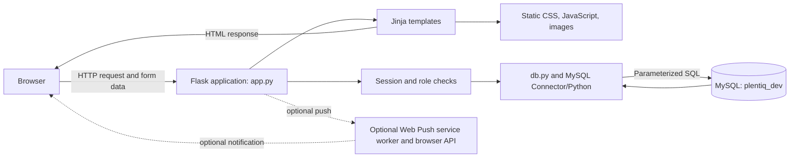

# Plentiq — Report Context and Flowchart Analysis

**Project:** Surplus Food Redistribution and Donation Management System  
**Reviewed:** 28 October 2026  
**Scope:** Active project root only; V1 was excluded. This is a source and schema reference for a later academic report, not the final report.

## Status key

- **IMPLEMENTED** — supported by the current application source and schema.
- **PARTIAL** — part of the feature exists, but requires configuration or further verification.
- **MISSING** — no supporting route/table/workflow was found.
- **NOT VERIFIED** — source exists, but the relevant end-to-end scenario was not confirmed with real workflow data.

## 1. System architecture

The browser requests a route from the Flask application in `app.py`. Flask checks the session and role, validates submitted form data, runs parameterized SQL through `db.py` and MySQL Connector/Python, then renders a Jinja template or redirects. Jinja templates use static CSS and JavaScript from `static/`. `db.py` loads the root `.env` file and creates connections to the configured MySQL database. Secret and connection values are intentionally omitted here.

### Main source files

| Area | Files and purpose |
|---|---|
| Application | `app.py` is the Flask entry point. Direct execution starts the local app on port 5001 (`app.py:3885-3886`). |
| Database | `db.py` loads the root environment file and creates MySQL connections (`db.py:1-36`). `db_check.py` is a read-only connection check. |
| SQL schema | `Tab 1 — Database, accounts, profiles, and lookup lists.sql`; `Tab 2 — Donations, food items, and acceptor needs.sql`; `Tab 3 — Requests, collections, reports, admin actions, and notifications.sql`. |
| Schema migrations | `database_migrations/004_profile_and_donation_fields.sql` through `009_pickup_verification.sql` add later fields and support tables. |
| Frontend | Role layouts and pages are under `templates/donor/`, `templates/acceptor/`, `templates/admin/`, plus shared pages under `templates/` and `templates/shared/`. |
| Assets | Shared and role-specific styling is under `static/css/`; page behavior is under `static/js/`; images are under `static/images/`. |
| Dependencies | `requirements.txt` lists Flask, MySQL Connector/Python, python-dotenv, and pywebpush. Availability/configuration is a separate runtime question. |

Browser push has subscription routes and a `push_subscriptions` table, but project notes state that the local environment lacks the required VAPID configuration and the pywebpush installation was not completed. Treat browser push as **PARTIAL / NOT VERIFIED**; in-app notifications are implemented and stored in MySQL.

## 2. Actual database design

### Correction to the supplied six-table list

The attached brief names `users`, `food_categories`, `food_listings`, `donation_requests`, `collection_schedules`, and `distribution_records`. That is **not** the active schema. The SQL and live database use 18 core tables plus `push_subscriptions` from migration 006, for **19 tables**. Food listings are represented by `donations` and child `donation_items`; pickup records are in `collections`. There is no `distribution_records` table. The current schema also has pickup-verification metadata from migration 009.

A read-only `information_schema` inspection on 28 October 2026 confirmed database `plentiq_dev`, 19 base tables, nullable `donation_items.prepared_at`, and all three collection pickup-PIN columns. No rows or application data were read for this check.

### Table purpose, relationships, and constraints

The base DDL is in the three Tab SQL files; later fields are in the migrations. All listed tables have primary keys. Key explicit constraints and indexes are summarized below; this is not a substitute for the full DDL.

| Table | Purpose and important relationships / integrity rules |
|---|---|
| `roles` | Role lookup (`role_id`, `role_code`, `role_name`). `role_code` is unique. One role can be assigned to many users. |
| `users` | Accounts (`user_id`, `role_id`, `full_name`, `email`, `password_hash`, `phone`, `account_status`). Email is unique; role is an FK; role/status index; status CHECK permits active or blocked. Password values are hashes and are not included in this document. |
| `donor_profiles` | Optional one-to-one donor profile keyed by `user_id`, also an FK to `users`; stores donor type and default city. |
| `acceptor_profiles` | Optional one-to-one acceptor profile keyed by `user_id`, also an FK to `users`; stores acceptor type and optional organization name. |
| `user_locations` | A user can save multiple locations; each location references a user. Includes address parts, optional coordinates and a default flag; coordinate pairing/ranges are checked; indexed by user. |
| `food_categories` | Food category lookup. Category code and name are unique; rows have an active flag. |
| `dietary_options` | Dietary lookup. Dietary code is unique. |
| `quantity_units` | Quantity-unit lookup. Unit code is unique. |
| `donations` | Donation/listing parent with donor FK, pickup address/contact, optional coordinates, pickup window and status. Donor/status and pickup-end indexes; CHECKs constrain status, pickup window ordering and coordinate pairing/range. |
| `donation_items` | One or more food items per donation. FKs to donation, category, dietary option and unit. Stores food name, description, photo reference, total/available quantity, serving details, prepared time and approximate expiry. Indexes by donation and category/expiry; CHECKs require positive total quantity, available quantity from zero through total, and expiry after prepared time when expiry is provided. |
| `acceptor_needs` | Acceptor-posted need, linked to user and dietary option. Stores location, people count, schedule, meal period, notes and status. Acceptor/status index; CHECKs require positive people count, valid status and paired coordinates. `needed_for` and `meal_period` were added by migration 005. |
| `acceptor_need_categories` | Composite-PK bridge between needs and food categories. Implements the many-to-many relation between acceptor needs and categories. |
| `donation_requests` | Request from an acceptor for a donation item, with quantity, status, timestamps, optional deciding user and rejection reason. FKs to item, acceptor and decider; item/status and acceptor/status indexes; positive-quantity and status CHECKs. The schema has no UNIQUE constraint preventing repeated requests; the application checks for the same acceptor's pending/approved request. |
| `collections` | Pickup state for an approved request. `request_id` is unique and an FK, so a request has zero or one collection. Stores scheduled pickup, collected timestamp and status. Migration 009 adds `pickup_pin_nonce`, `pickup_pin_attempts` and `pickup_pin_attempted_at`; the PIN itself is not stored. |
| `report_reasons` | Lookup for report reason; reason code is unique and can be active/inactive. Migration 007 seeds the supported reasons. |
| `reports` | Participant report with request, optional collection, reporter/reported users, reason, status and review details. FKs to all referenced entities; status and reported-user indexes; CHECK prevents self-report and constrains report status. |
| `moderation_actions` | Admin action history with admin and target-user FKs, action code, optional reason and timestamp. Target/time index; action CHECK permits block/unblock. |
| `notifications` | In-app notification for one recipient, optionally linked to donation/request, with message, created time and nullable `read_at`. Recipient/read index; FKs preserve the links. |
| `push_subscriptions` | Optional browser Push API subscriptions, added by migration 006. User FK, unique endpoint hash and user index. |

Key DDL references: roles, users, profiles, locations and lookups in `Tab 1…sql:7-104`; donations, items and needs in `Tab 2…sql:3-110`; requests, collections, reports, moderation and notifications in `Tab 3…sql:3-120`; push table in `database_migrations/006_push_subscriptions.sql:6-21`; pickup verification in `database_migrations/009_pickup_verification.sql:6-16`. Migration 008 makes `prepared_at` nullable (`database_migrations/008_optional_produce_prepared_at.sql:6-7`).

### ER diagram — current schema

This diagram shows the actual 19-table model. It intentionally has no distribution entity.

~~~mermaid
erDiagram
    ROLES {
        int role_id PK
        string role_code UK
        string role_name
    }
    USERS {
        int user_id PK
        int role_id FK
        string full_name
        string email UK
        string password_hash
        string phone
        string account_status
    }
    DONOR_PROFILES {
        int user_id PK, FK
        string donor_type
        string default_city
    }
    ACCEPTOR_PROFILES {
        int user_id PK, FK
        string acceptor_type
        string organisation_name
    }
    USER_LOCATIONS {
        int location_id PK
        int user_id FK
        string city
        string area
        decimal latitude
        decimal longitude
        boolean is_default
    }
    FOOD_CATEGORIES {
        int category_id PK
        string category_code UK
        string category_name UK
    }
    DIETARY_OPTIONS {
        int dietary_option_id PK
        string dietary_code UK
        string dietary_name
    }
    QUANTITY_UNITS {
        int unit_id PK
        string unit_code UK
        string unit_name
    }
    DONATIONS {
        int donation_id PK
        int donor_user_id FK
        string city
        string area
        datetime pickup_starts_at
        datetime pickup_ends_at
        string status_code
    }
    DONATION_ITEMS {
        int item_id PK
        int donation_id FK
        int category_id FK
        int dietary_option_id FK
        int unit_id FK
        string food_name
        decimal total_quantity
        decimal available_quantity
        datetime prepared_at
        datetime approximate_expiry_at
    }
    ACCEPTOR_NEEDS {
        int need_id PK
        int acceptor_user_id FK
        int dietary_option_id FK
        int people_count
        date needed_for
        string meal_period
        string status_code
    }
    ACCEPTOR_NEED_CATEGORIES {
        int need_id PK, FK
        int category_id PK, FK
    }
    DONATION_REQUESTS {
        int request_id PK
        int item_id FK
        int acceptor_user_id FK
        int decided_by_user_id FK
        decimal quantity_requested
        string status_code
    }
    COLLECTIONS {
        int collection_id PK
        int request_id FK, UK
        string status_code
        datetime scheduled_pickup_at
        datetime collected_at
        string pickup_pin_nonce
    }
    REPORT_REASONS {
        int reason_id PK
        string reason_code UK
        string reason_label
    }
    REPORTS {
        int report_id PK
        int request_id FK
        int collection_id FK
        int reporter_user_id FK
        int reported_user_id FK
        int reason_id FK
        int reviewed_by_user_id FK
        string status_code
    }
    MODERATION_ACTIONS {
        int action_id PK
        int admin_user_id FK
        int target_user_id FK
        string action_code
    }
    NOTIFICATIONS {
        int notification_id PK
        int recipient_user_id FK
        int donation_id FK
        int request_id FK
        datetime read_at
    }
    PUSH_SUBSCRIPTIONS {
        int subscription_id PK
        int user_id FK
        string endpoint_hash UK
    }

    ROLES ||--o{ USERS : assigns
    USERS ||--o| DONOR_PROFILES : has
    USERS ||--o| ACCEPTOR_PROFILES : has
    USERS ||--o{ USER_LOCATIONS : saves
    USERS ||--o{ DONATIONS : creates
    DONATIONS ||--o{ DONATION_ITEMS : contains
    FOOD_CATEGORIES ||--o{ DONATION_ITEMS : classifies
    DIETARY_OPTIONS ||--o{ DONATION_ITEMS : labels
    QUANTITY_UNITS ||--o{ DONATION_ITEMS : measures
    USERS ||--o{ ACCEPTOR_NEEDS : posts
    DIETARY_OPTIONS ||--o{ ACCEPTOR_NEEDS : describes
    ACCEPTOR_NEEDS ||--o{ ACCEPTOR_NEED_CATEGORIES : selects
    FOOD_CATEGORIES ||--o{ ACCEPTOR_NEED_CATEGORIES : included_in
    DONATION_ITEMS ||--o{ DONATION_REQUESTS : receives
    USERS ||--o{ DONATION_REQUESTS : requests_as_acceptor
    USERS o|--o{ DONATION_REQUESTS : decides
    DONATION_REQUESTS ||--o| COLLECTIONS : may_create
    DONATION_REQUESTS ||--o{ REPORTS : concerns
    COLLECTIONS o|--o{ REPORTS : may_concern
    USERS ||--o{ REPORTS : reports
    USERS ||--o{ REPORTS : is_reported
    REPORT_REASONS ||--o{ REPORTS : categorizes
    USERS o|--o{ REPORTS : reviews
    USERS ||--o{ MODERATION_ACTIONS : administers
    USERS ||--o{ MODERATION_ACTIONS : is_target
    USERS ||--o{ NOTIFICATIONS : receives
    DONATIONS o|--o{ NOTIFICATIONS : may_reference
    DONATION_REQUESTS o|--o{ NOTIFICATIONS : may_reference
    USERS ||--o{ PUSH_SUBSCRIPTIONS : subscribes
~~~

The user relationships with multiple roles are separate FKs; the database does not enforce that `decided_by_user_id` is a donor or that `admin_user_id` has the admin role. Those permissions are enforced by Flask route guards and application logic.

The ER cardinalities show what the foreign keys allow: a donation or need can technically exist without child rows at the database level. The application form enforces one or more food items/categories for normal submissions.

## 3. Actual workflow analysis

| Workflow | Routes / functions and templates | SQL effects and outcome |
|---|---|---|
| A. Authentication and roles — **IMPLEMENTED** | Login `GET/POST /login`, `app.py:609-670`; role landing `/account/home`, `673-684`; logout `686-689`; access guards `388-444`; login page `templates/login.html`. | Selects `users` joined to `roles`; accepts active accounts whose password hash verifies; stores user ID/name/role in Flask session and redirects by role. No public registration route was found; `seed_accounts.py` is the local account-seeding utility and hashes entered passwords. Sample donor preview mode is a deliberate route-guard exception; normal database-backed paths enforce role and active-account checks. |
| B. Donor creates/manages listing — **IMPLEMENTED** | `GET/POST /donor/donations/new`, `app.py:2539-2648`; payload validation `2158-2410`; save helper `2411-2520`; detail and list `2654-2673`, `1187+`; templates `templates/donor/donation_form.html`, `donations.html`, `donation_detail.html`. | Validates item, quantity, category/unit, dates, contact and pickup details; transaction inserts a donation parent plus one or more donation items, optionally saves profile contact fields, writes notifications for nearby acceptors and commits. SQL tables include `donations`, `donation_items`, lookup tables, and `notifications`; uploaded photos go to `static/uploads/` and the database stores a reference. Expiry maximum is 7 days for the “Fruits and Vegetables” category and 30 days for other categories (`app.py:2145-2146`). |
| C. Acceptor browses and requests — **IMPLEMENTED** | Catalog `GET /acceptor/food`, `app.py:3238-3271`; matching query `_load_nearby_donations`, `1621-1704`; POST `/acceptor/donations/<item_id>/request`, `3436-3534`; templates `templates/acceptor/food.html`, `requests.html`. | Feed uses saved coordinates, a 25 km radius, deadline/availability filters, category and dietary filters, and urgency ordering. Request transaction checks location, active listing, expiry, duplicate open request and remaining quantity; inserts `donation_requests`, creates donor notification, commits, then attempts optional browser push. |
| D. Donor approves/rejects — **IMPLEMENTED** | Donor-only POST `/donor/requests/<request_id>/<decision>`, `app.py:3763-3882`; `templates/donor/requests.html`. | The donor owns the listing and handles approve/reject. Admin pages can inspect requests, but no admin approve/reject route was found. Reject records the decision/reason and notifies the acceptor. Approve also performs the quantity and collection work in workflow E. |
| E. Approval and quantity allocation — **IMPLEMENTED** | `donor_decide_request`, `app.py:3777-3882`. | Transaction locks request, donation and item rows; verifies pending state, donor ownership, active status, unexpired pickup deadline and sufficient available quantity. It subtracts quantity once, updates request, creates a collection with a PIN nonce, updates parent donation state, writes an in-app notification and commits. Invalid state/quantity or a MySQL error rolls back. `FOR UPDATE` plus the pending-state check prevents concurrent duplicate approval. |
| F. Pickup scheduling — **IMPLEMENTED** | POST `/donor/collections/<collection_id>/schedule`, `app.py:2731-2807`; `templates/donor/collections.html`. | Locks collection and related rows; requires the donor owner and scheduled state; requires a future time within the listing start and the earlier of pickup-end/item-expiry. Updates `collections.scheduled_pickup_at` and notifies both participants. |
| G. Collection state and verification — **IMPLEMENTED; scenario NOT VERIFIED end to end** | POST `/donor/collections/<collection_id>/<action>`, `app.py:2816-2950`; acceptor records load at `1737-1792`; templates `templates/donor/collections.html`, `templates/acceptor/requests.html`. | Acceptors see their own derived four-digit PIN; donors do not receive the PIN in their collection query. It is derived by HMAC from a per-collection random nonce and the Flask secret, not stored in cleartext (`app.py:31-43`). Donor can mark collected only after pickup starts and after PIN check; five failed tries trigger a 15-minute pause. Missed/cancelled flows update collection/request and return reserved quantity; notifications are saved. Migration 009 columns are present in the live database. |
| H. NGO records distribution — **MISSING** | No distribution route, controller, template or distribution table found. | The application records collection status and quantity requested/collected, but not how food is subsequently distributed or the number of recipients served. The donor print page is a completed-collection summary, not proof of tax value, food safety certification or distribution totals. |

Additional admin functions include dashboard aggregates/charts, user status moderation, donation/request views and report review (`app.py:692-1144`, `templates/admin/`). Admin can block/unblock accounts and review submitted reports; this is separate from approving donation requests.

## 4. Flowchart specifications

### Overall lifecycle

~~~mermaid
flowchart TD
    A[Donor creates donation and food item or items] --> B[(Save donations and donation_items)]
    B --> C[Nearby acceptor catalog: within 25 km]
    C --> D{Acceptor selects an item and quantity?}
    D -- No --> C
    D -- Yes --> E[Validate location, expiry, availability and duplicate request]
    E --> F[(Save pending donation_request and notify donor)]
    F --> G{Donor decision}
    G -- Reject --> H[(Save rejected state and notify acceptor)]
    G -- Approve --> I[Lock rows and validate deadline and quantity]
    I --> J[(Reserve quantity; save approved request and collection with PIN nonce)]
    J --> K[Donor schedules agreed pickup inside safe window]
    K --> L{Handover outcome}
    L -- Correct PIN after pickup starts --> M[(Mark collected and record collected_at)]
    L -- Missed or cancelled --> N[(Update status; return quantity when listing remains valid)]
    M --> O[Donor may print collection summary]
    M --> P[Distribution record]
    P --> Q[NOT IMPLEMENTED: no distribution workflow or table]
~~~

### Request approval and quantity allocation

~~~mermaid
flowchart TD
    A[Donor submits approve or reject] --> B{Donor session and listing ownership valid?}
    B -- No --> Z[Reject or redirect; no approval]
    B -- Yes --> C[Begin transaction; SELECT request FOR UPDATE]
    C --> D{Request exists and remains pending?}
    D -- No: duplicate or stale decision --> R[Rollback]
    D -- Yes --> E[Lock donation and check active state and effective deadline]
    E --> F{Listing still eligible?}
    F -- No --> R
    F -- Yes --> G{Decision}
    G -- Reject --> H[Set rejected status and optional reason]
    H --> I[Write acceptor notification]
    I --> K[Commit]
    G -- Approve --> J[SELECT item available_quantity FOR UPDATE]
    J --> L{Requested quantity available?}
    L -- No --> R
    L -- Yes --> M[Subtract reserved quantity]
    M --> N[Set request approved and insert collection with PIN nonce]
    N --> O[Refresh donation active or fully_allocated status]
    O --> I
    R --> S[Return an error; database changes are rolled back]
~~~

### Collection scheduling and status

~~~mermaid
flowchart TD
    A[Approved request creates scheduled collection] --> B[Acceptor sees pickup time and own PIN]
    B --> C[Donor chooses agreed time]
    C --> D{Future time within pickup start and effective deadline?}
    D -- No --> E[Reject schedule change]
    D -- Yes --> F[(Save scheduled_pickup_at; notify both participants)]
    F --> G{Donor action}
    G -- Collected --> H{Pickup has started and four-digit PIN matches?}
    H -- No --> I[Reject; increment failed-attempt count]
    I --> J{Five failed attempts?}
    J -- Yes --> K[Pause PIN attempts for 15 minutes]
    J -- No --> B
    H -- Yes --> L[(Mark collection collected; store collected_at; notify acceptor)]
    G -- Missed --> M{Agreed time or safe window passed?}
    M -- No --> E
    M -- Yes --> N[(Mark missed; cancel request; return quantity if listing still valid)]
    G -- Cancelled --> O[(Mark cancelled; cancel request; return quantity if listing still valid)]
~~~

### Distribution recording

~~~mermaid
flowchart TD
    A[Collection marked collected] --> B{Distribution workflow exists?}
    B -- No --> C[Stop: no distribution form, route or distribution_records table]
    B -- Yes --> D[Future workflow only; validation and persistence are not implemented]
~~~

### Architecture

The architecture diagram is in section 1. It shows the app's actual browser, Flask, Jinja/static assets, database connector and MySQL boundary. Optional push is drawn separately because subscription and send code do not prove that this environment can deliver push alerts.

## 5. DBMS concepts evidenced by the project

| Concept | Evidence and status |
|---|---|
| Relational model and referential integrity | **IMPLEMENTED.** PKs, FKs and one-to-one / one-to-many relations are declared in the Tab SQL files. |
| Unique, CHECK and index constraints | **IMPLEMENTED in schema.** Examples: unique user email; category/diet/unit lookup codes; positive quantity and valid statuses; unique collection per request; indexes for donor/status, item/status, notifications/read and report queues. See table references above. |
| JOIN queries | **IMPLEMENTED.** Login joins users to roles (`app.py:637-643`); acceptor feed and dashboard queries join donations, items and lookup tables (`app.py:1635-1665`); collection/report/admin queries join related records. |
| Aggregate queries | **IMPLEMENTED.** Counts and sums support admin dashboards (`app.py:692-960`); pending requested quantity is summed for listing availability (`app.py:3498-3503`). |
| Stored procedures/functions | **MISSING.** No `CREATE PROCEDURE`, `CREATE FUNCTION` or `CALL` statement was found in active SQL files. Application behavior uses Python functions and parameterized SQL. |
| Transactions and rollback | **IMPLEMENTED.** Donation saving, need posting, requests, decisions, collections, reports and moderation use transaction boundaries and rollback on error; e.g. `app.py:2411-2520`, `3438-3534`, `3777-3882`. |
| Row-level locking | **IMPLEMENTED.** `SELECT ... FOR UPDATE` is used for request decisions, pickup scheduling/status and request creation to serialize conflicting operations. |
| Concurrent allocation and idempotence | **IMPLEMENTED in request approval.** The request row is locked, pending status is rechecked, the item quantity is locked, and an approved request is only decremented once. A database UNIQUE constraint also permits at most one collection per request. |
| Distribution accounting | **MISSING.** No post-collection distribution quantity, recipient count or distribution record is persisted. Do not claim “people fed” or “meals served” from the current database. |

Expiry policy note: the UI and server-side validation use a maximum of 7 days for fruits and vegetables and 30 days for other categories (`app.py:2145-2146`, validation starts `2227`). These are application limits, not a food-safety certification.

## 6. Testing evidence and remaining verification

### Evidence available

- A read-only schema inspection on 28 October 2026 connected to `plentiq_dev`, found 19 tables, confirmed `prepared_at` is nullable and confirmed the three pickup PIN columns. It did not read or change user/demo records.
- The previous project verification pass recorded: Python compilation for `app.py`, `db.py`, `seed_accounts.py` and `db_check.py` passed; 31 Jinja templates compiled; 7 static JavaScript files passed `node --check`; a Flask read-only GET sweep covered 28 routes without HTTP 5xx; and a completed-collection receipt page returned HTTP 200. These are agent-session checks, not a committed automated test report.
- The previous nearby catalog check returned zero eligible listings, so the urgent badge and ordering were not visually demonstrated with an eligible expiring item.
- No active formal `tests/` directory or test suite was found in the project root. `db_check.py` is a connection check, not a workflow test.

### Not verified end to end

- Re-run a full role scenario with controlled demo data: create donation → acceptor request → donor approval and quantity change exactly once → PIN shown only to acceptor → donor confirms correct PIN → collected timestamp → printable summary.
- Exercise wrong PIN, five-attempt pause, expired pickup, insufficient quantity, duplicate request/approval, missed pickup, cancellation, quantity restoration, and notification read state.
- Demonstrate an urgent listing whose deadline is within two hours and confirm it appears ahead of non-urgent eligible listings.
- Confirm browser push in a configured browser/environment. The in-app notification path is the reliable implemented record of truth.
- Verify the distribution workflow as unavailable; no valid source/data exists to test it.

No data-changing tests were run while preparing this document.

## 7. Small code selection for a maximum two-page report

Use these excerpts only; together they are short enough to annotate without copying the full application.

| Source excerpt | DBMS/security concept | Why it merits space |
|---|---|---|
| `app.py:637-658`, login query through role session creation | JOIN, hash verification, role-based session | Compact proof that account identity and role come from the relational database and that passwords are verified as hashes. |
| `app.py:3792-3842`, approval transaction, locks, quantity check/update and collection insert | Transaction, `FOR UPDATE`, constraint-aware quantity allocation | Best example of concurrency control and preventing a request from reserving quantity twice. |
| `Tab 3 — Requests, collections, reports, admin actions, and notifications.sql:27-40`, collections DDL | PK, unique FK, status CHECK | Shows the database enforcing at most one collection for each request and restricting its states. |

If only one page is available, keep the approval excerpt and collections DDL; explain login in prose.

## 8. Screenshots and questions

### Mandatory evidence to capture for the final academic report/demo

1. Current login page and the role-specific donor, acceptor and admin workspaces.
2. Donor listing form and saved listing; avoid showing private phone/address details.
3. Acceptor nearby catalog and submitted request, followed by the donor's pending request card.
4. Before/after database evidence for one approved request showing request status, available quantity and its one collection record. Use sanitized test records; never include password hashes or personal contact values.
5. Acceptor view of the pickup PIN, donor PIN-entry modal without revealing the correct PIN in that donor screenshot, then collected status.
6. Printable completed-collection summary and browser print preview; label it as a collection summary, not a tax receipt.
7. Admin analytics/report review and the database schema overview. Workbench evidence should show table names/relationships and relevant status/quantity rows only, with credentials and unrelated records hidden.
8. A generated ER diagram from the current schema and a short verification-results table showing tested route/workflow, result and date.

### Optional evidence

- Landing page, donor and acceptor profile/location selection, map/current-location flow, read/unread notification state, urgent-rescue badge, report submission/review, and account block/unblock.
- Browser push pop-up, only if VAPID keys, dependency and browser subscription are configured and delivery is confirmed.

### Questions only the source cannot answer

1. What college, department, course, student/team names, roll numbers and supervisor details should appear on the final report cover?
2. Does the college prescribe a report template, citation style, page limit or required chapter order?
3. Should the report consistently call recipient organizations “acceptors” (the implemented role name) or explain them as NGOs/acceptors?
4. Which of the suggested end-to-end screenshots and manual scenarios will you personally capture during the final demo?
