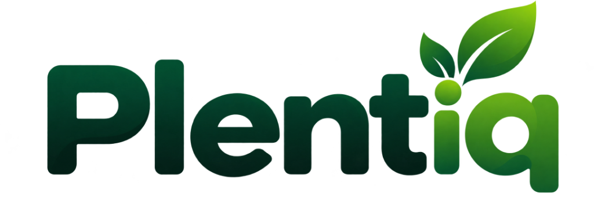
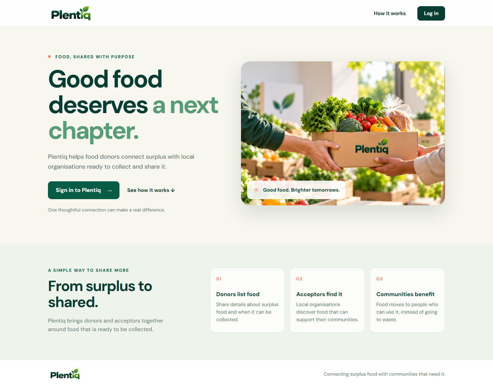
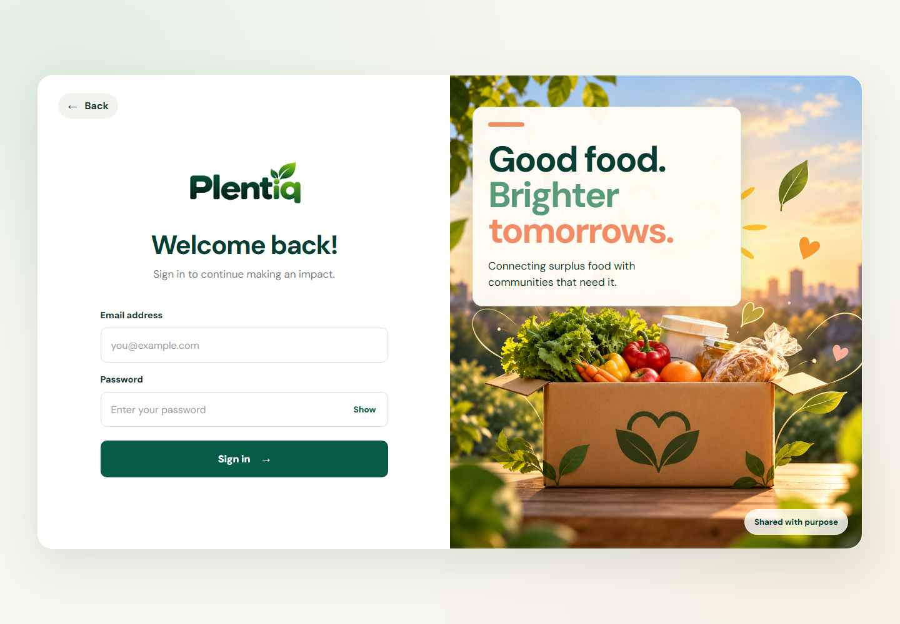

# Plentiq

**Food, shared with purpose.** Plentiq is a Flask and MySQL application that connects food donors with nearby community organisations so surplus food can be requested, collected, and tracked.

<p align="center">
  
</p>

## Screenshots

| Landing page | Sign in |
| --- | --- |
|  |  |

## What the app includes

- **Donor workspace:** create and manage food listings, review requests, coordinate collection, and view donation activity.
- **Acceptor workspace:** find nearby available food, post community needs, request donations, and track collections.
- **Admin workspace:** review platform activity, reports, and account moderation information.
- **Workflow support:** role-based sign-in, location-aware matching (up to 25 km when coordinates are available), in-app notifications, participant reports, and collection status tracking.
- **Pickup verification:** a short pickup PIN is derived from the application secret and a per-collection nonce; the PIN itself is not stored in MySQL.
- **Printable collection summary:** completed collections can be opened in a print-friendly view and saved as PDF through the browser.

Browser push alerts require VAPID configuration. In-app notifications do not require browser push setup.

## Requirements

- Python 3.12 or newer
- MySQL 8.0 or newer
- Windows PowerShell (commands below use PowerShell)

## Run locally

### 1. Create a Python environment

From the project root:

```powershell
py -3.12 -m venv .venv
.\.venv\Scripts\Activate.ps1
python -m pip install -r requirements.txt
```

### 2. Create the MySQL schema

In MySQL Workbench, run the three root schema scripts in this order:

1. `Tab 1 — Database, accounts, profiles, and lookup lists.sql`
2. `Tab 2 — Donations, food items, and acceptor needs.sql`
3. `Tab 3 — Requests, collections, reports, admin actions, and notifications.sql`

Then apply migrations `database_migrations/004` through `database_migrations/010` in numeric order. Apply a migration only once to a database that does not already have its changes. Keep the schema scripts and migrations as the source of truth; do not run duplicate ad hoc SQL.

### 3. Configure local settings

```powershell
Copy-Item .env.example .env
```

Set your local MySQL connection values and a long random `PLENTIQ_SECRET_KEY` in `.env`. Do not commit `.env` or share its values. The default database name in the SQL scripts and example is `plentiq_dev`.

### 4. Add the initial accounts (if needed)

`seed_accounts.py` provisions the five starter accounts currently defined in that file. It prompts for each password and stores Werkzeug password hashes. Run it only when those accounts do not already exist:

```powershell
python seed_accounts.py
```

### 5. Check the database and start Plentiq

```powershell
python db_check.py
python app.py
```

Open **http://127.0.0.1:5001**. Stop the server with `Ctrl+C`.

## Configuration reference

`.env.example` lists the supported local settings. MySQL credentials and the Flask session secret belong in the ignored `.env` file. Browser push is optional and needs VAPID public/private key settings; the app can be used with in-app notifications without them.

## Project layout

```text
app.py                 Flask routes and application workflows
db.py                  MySQL connection configuration
database_migrations/   Incremental database changes (004–010)
static/                CSS, JavaScript, images, and local upload path
templates/             Landing, sign-in, donor, acceptor, and admin pages
screenshots/           README screenshots of the public pages
```

The old `v1/` project and local-only files such as `.env` and `.venv` are excluded from Git.
